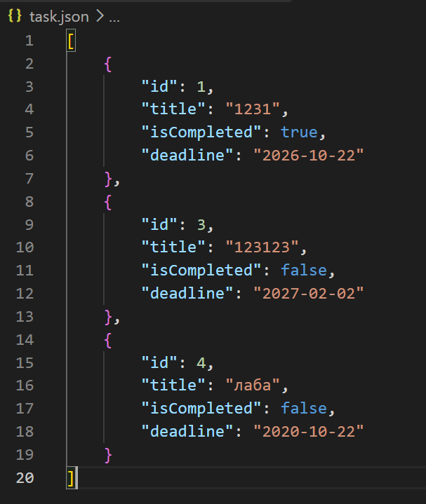
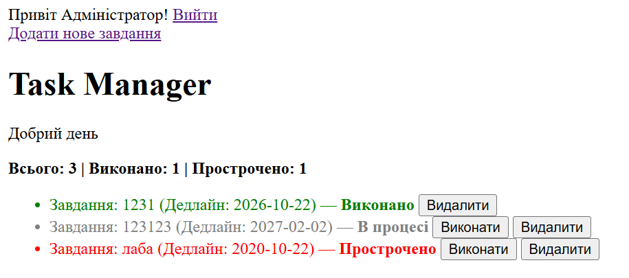

### Код класу Task ('Task.php')

```php
<?php

declare(strict_types=1);

class Task
{
    public function __construct(
        public readonly int    $id,
        private string         $title,
        private bool           $isCompleted = false,
        private ?string        $deadline    = null,
    ) {
        if (empty(trim($title))) {
            throw new InvalidArgumentException('Назва завдання не може бути пустою!');
        }
    }

    public function getId(): int { return $this->id; }
    public function getTitle(): string { return $this->title; }
    public function isCompleted(): bool { return $this->isCompleted; }
    public function getDeadline(): ?string { return $this->deadline; }

    public function isOverdue(): bool
    {
        if ($this->isCompleted || $this->deadline === null) {
            return false;
        }
        return strtotime($this->deadline) < time();
    }
    
    public function complete(): void { $this->isCompleted = true; }

    public function getStatusLabel(): string
    {
        if ($this->isCompleted) return 'Виконано';
        if ($this->isOverdue()) return 'Прострочено';
        return 'В процесі';
    }
        
    public function toArray(): array
    {
        return [
            'id'          => $this->id,
            'title'       => $this->title,
            'isCompleted' => $this->isCompleted,
            'deadline'    => $this->deadline,
        ];
    }

    public static function fromArray(array $data): self
    {
        return new self(
            id:          $data['id'],
            title:       $data['title'],
            isCompleted: $data['isCompleted'] ?? false,
            deadline:    $data['deadline']    ?? null,
        );
    }
}
```

### Код класу TaskRepository

```php
<?php

declare(strict_types=1);

require_once __DIR__ . '/Task.php';

class TaskRepository
{
    private array $tasks = [];

    public function __construct(private string $storageFile)
    {
        $this->load();
    } 

    public function findAll(): array { return $this->tasks; }

    public function findById(int $id): ?Task
    {
        foreach ($this->tasks as $task) {
            if ($task->getId() === $id) return $task;
        }
        return null;
    }

    public function add(string $title, ?string $deadline = null): Task
    {
        $task = new Task($this->generateNextId(), $title, false, $deadline);
        $this->tasks[] = $task;
        $this->save();
        return $task;
    }

    public function complete(int $id): bool
    {
        $task = $this->findById($id);
        if (!$task) return false;
        $task->complete();
        $this->save();
        return true;
    }

    public function delete(int $id): bool
    {
        foreach ($this->tasks as $key => $task) {
            if ($task->getId() === $id) {
                unset($this->tasks[$key]);
                $this->tasks = array_values($this->tasks);
                $this->save();
                return true;
            }
        }
        return false;
    }

    public function countCompleted(): int
    {
        return count(array_filter($this->tasks, fn(Task $t) => $t->isCompleted()));
    }

    public function countOverdue(): int
    {
        return count(array_filter($this->tasks, fn(Task $t) => $t->isOverdue()));
    }

    private function generateNextId(): int
    {
        if (empty($this->tasks)) return 1;
        return max(array_map(fn(Task $t) => $t->getId(), $this->tasks)) + 1;
    }

    private function load(): void
    {
        if (!file_exists($this->storageFile)) { $this->tasks = []; return; }
        $data = json_decode(file_get_contents($this->storageFile), true) ?? [];
        $this->tasks = array_map(fn(array $item) => Task::fromArray($item), $data);
    }

    private function save(): void
    {
        $data = array_map(fn(Task $t) => $t->toArray(), $this->tasks);
        file_put_contents(
            $this->storageFile,
            json_encode($data, JSON_PRETTY_PRINT | JSON_UNESCAPED_UNICODE)
        );
    }
}
```

## Скріншоти




## Відповіді на контрольні запитання

### 1. Клас проти масиву
Масив — це просто набір даних. Клас об'єднує дані та логіку (методи) в єдине ціле, захищаючи код від помилок і хаосу.

### 2. Private-властивість
Доступна лише всередині класу для захисту даних (інкапсуляція). Читають її через публічні геттери (наприклад, `getTitle()`).

### 3. `public readonly int $id`
Це скорочення конструктора (Constructor Promotion) та захист `readonly` (значення не можна змінити після створення). `$id` постійний, а статус `$isCompleted` може змінюватися.

### 4. Статичний метод `Task::fromArray()`
Створює об'єкт `Task` з масиву (наприклад, із JSON). Він static, тому що викликається на самому класі до того, як об'єкт існує.

### 5. Ланцюжок збереження (`$repo->add`)
Створюється об'єкт `Task` ➔ додається до масиву репозиторію ➔ метод `save()` переводить об'єкти в масиви через `toArray()` ➔ кодує в JSON (`json_encode`) ➔ записує у файл (`file_put_contents`).
