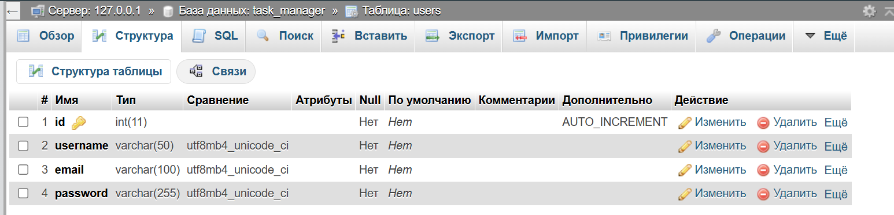
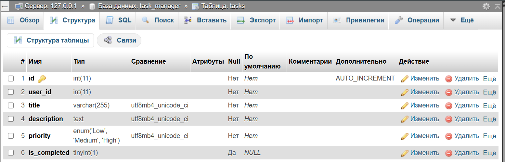
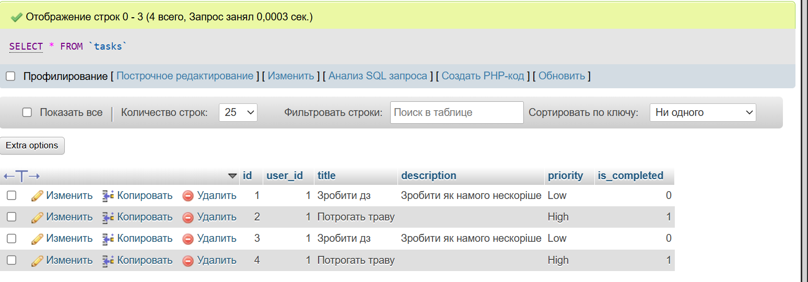
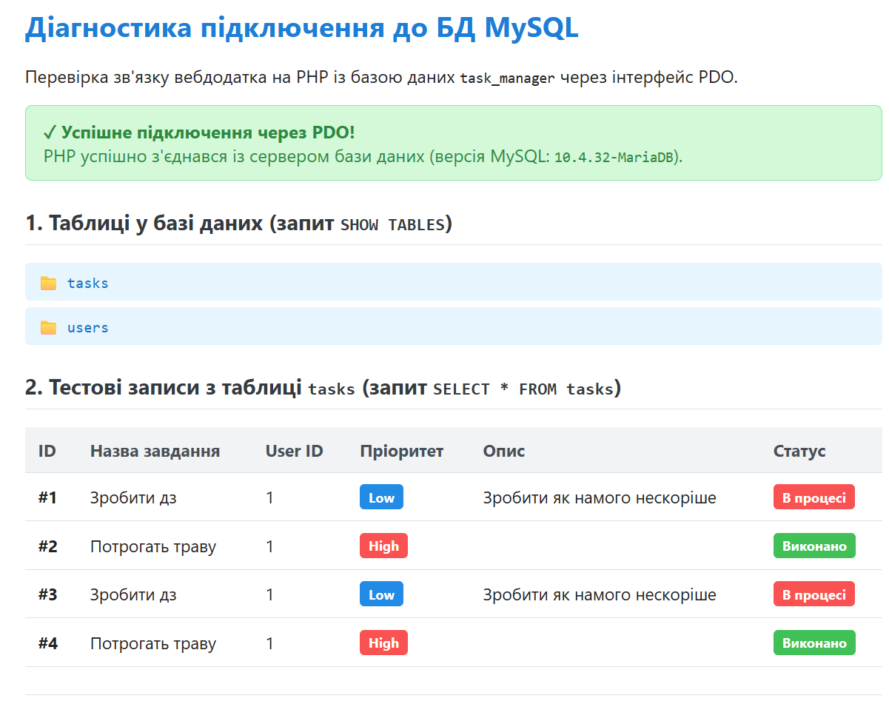

### Структура созданих таблиць
## USERS


## TASKS


### Cкриншот вкладки «Огляд» таблиці tasks


### Код test_db.php
```php
<?php
declare(strict_types=1);

$host = "127.0.0.1";
$port = '3306';
$dbname = 'task_manager';
$username = 'root';
$password = '';
$charset = 'utf8mb4';

$dsn = "mysql:host={$host};port={$port};dbname={$dbname};charset={$charset}";

$tables = [];
$tasks = [];
$connectionStatus = false;
$errorMessage = null;
$serverInfo = '';

$optins = [
    PDO::ATTR_ERRMODE => PDO::ERRMODE_EXCEPTION,
    PDO::ATTR_DEFAULT_FETCH_MODE => PDO::FETCH_ASSOC,
    PDO::ATTR_EMULATE_PREPARES => false,
];

try {
    $pdo = new PDO($dsn, $username, $password, $optins);
    $connectionStatus = true;
    $serverInfo = (string)$pdo->getAttribute(PDO::ATTR_SERVER_VERSION);

    $tablesStmt = $pdo->query('SHOW TABLES');
    $tables = $tablesStmt->fetchAll(PDO::FETCH_COLUMN);

    if (in_array('tasks', $tables, true)) {
        $tasksStmt = $pdo->query('SELECT * FROM tasks ORDER BY id ASC');
        $tasks = $tasksStmt->fetchAll();
    }
} catch(PDOException $e) {
    $connectionStatus = false;
    $errorMessage = $e->getMessage();
}
?>

<!DOCTYPE html>
<html lang="uk">
<head>
    <meta charset="UTF-8">
    <meta name="viewport" content="width=device-width, initial-scale=1.0">
    <title>Діагностика підключення</title>
    <style>
        body {
            font-family: -apple-system, BlinkMacSystemFont, "Segoe UI", Roboto, sans-serif;
            max-width: 820px;
            margin: 40px auto;
            padding: 0 20px;
            color: #222;
            background-color: #f8f9fa;
        }
        .card {
            background: #fff;
            padding: 24px;
            border-radius: 8px;
            box-shadow: 0 2px 4px rgba(0,0,0,0.08);
            margin-bottom: 20px;
        }
        h1 { margin-top: 0; font-size: 1.6em; color: #1c7ed6; }
        h2 { font-size: 1.2em; color: #343a40; margin-top: 24px; border-bottom: 1px solid #dee2e6; padding-bottom: 8px; }
        .alert-success {
            background: #d3f9d8;
            border: 1px solid #8ce99a;
            color: #2b8a3e;
            padding: 12px 16px;
            border-radius: 6px;
            margin-bottom: 20px;
        }
        .alert-error {
            background: #ffe3e3;
            border: 1px solid #ffa8a8;
            color: #c92a2a;
            padding: 12px 16px;
            border-radius: 6px;
            margin-bottom: 20px;
        }
        .badge {
            display: inline-block;
            padding: 3px 8px;
            border-radius: 4px;
            font-size: 0.8em;
            font-weight: bold;
        }
        .badge-success { background: #40c057; color: #fff; }
        .badge-danger  { background: #fa5252; color: #fff; }
        .badge-info    { background: #228be6; color: #fff; }
        .badge-warning { background: #f59f00; color: #fff; }
        table {
            width: 100%;
            border-collapse: collapse;
            margin-top: 12px;
        }
        th, td {
            text-align: left;
            padding: 10px 12px;
            border-bottom: 1px solid #dee2e6;
            font-size: 0.95em;
        }
        th { background: #f1f3f5; color: #495057; }
        ul.tables-list { list-style: none; padding: 0; margin: 12px 0; }
        ul.tables-list li {
            padding: 8px 12px;
            background: #e7f5ff;
            color: #1971c2;
            margin-bottom: 6px;
            border-radius: 4px;
            font-family: monospace;
            font-size: 1.05em;
        }
        .nav-links {
            margin-top: 25px;
            padding-top: 15px;
            border-top: 1px solid #dee2e6;
        }
        .nav-links a {
            color: #228be6;
            text-decoration: none;
            font-weight: 500;
        }
        .nav-links a:hover { text-decoration: underline; }
    </style>
</head>
<body>

    <div class="card">
        <h1>Діагностика підключення до БД MySQL</h1>
        <p>Перевірка зв'язку вебдодатка на PHP із базою даних <code><?= htmlspecialchars($dbname) ?></code> через інтерфейс PDO.</p>

        <?php if ($connectionStatus): ?>
            <div class="alert-success">
                <strong>✓ Успішне підключення через PDO!</strong><br>
                PHP успішно з'єднався із сервером бази даних (версія MySQL: <code><?= htmlspecialchars($serverInfo) ?></code>).
            </div>

            <h2>1. Таблиці у базі даних (запит <code>SHOW TABLES</code>)</h2>
            <?php if (!empty($tables)): ?>
                <ul class="tables-list">
                    <?php foreach ($tables as $table): ?>
                        <li>📁 <?= htmlspecialchars($table) ?></li>
                    <?php endforeach; ?>
                </ul>
            <?php else: ?>
                <p>У базі даних немає створених таблиць. Перевірте виконання Кроків 3 та 4.</p>
            <?php endif; ?>

            <h2>2. Тестові записи з таблиці <code>tasks</code> (запит <code>SELECT * FROM tasks</code>)</h2>
            <?php if (!empty($tasks)): ?>
                <table>
                    <thead>
                        <tr>
                            <th>ID</th>
                            <th>Назва завдання</th>
                            <th>User ID</th>
                            <th>Пріоритет</th>
                            <th>Опис</th>
                            <th>Статус</th>
                        </tr>
                    </thead>
                    <tbody>
                        <?php foreach ($tasks as $task): ?>
                            <tr>
                                <td><strong>#<?= htmlspecialchars((string)($task['id'] ?? '')) ?></strong></td>
                                <td><?= htmlspecialchars((string)($task['title'] ?? '')) ?></td>
                                <td><?= htmlspecialchars((string)($task['user_id'] ?? '')) ?></td>
                                <td>
                                    <?php
                                    $p = $task['priority'] ?? 'Medium';
                                    $badgeClass = match ($p) {
                                        'High' => 'badge-danger',
                                        'Low' => 'badge-info',
                                        default => 'badge-warning',
                                    };
                                    ?>
                                    <span class="badge <?= $badgeClass ?>"><?= htmlspecialchars((string)$p) ?></span>
                                </td>
                                <td><?= htmlspecialchars((string)($task['description'] ?? '—')) ?></td>
                                <td>
                                    <?php if (!empty($task['is_completed'])): ?>
                                        <span class="badge badge-success">Виконано</span>
                                    <?php else: ?>
                                        <span class="badge badge-danger">В процесі</span>
                                    <?php endif; ?>
                                </td>
                            </tr>
                        <?php endforeach; ?>
                    </tbody>
                </table>
            <?php else: ?>
                <p>У таблиці <code>tasks</code> поки немає записів. Додайте 2–3 тестові завдання через вкладку «Вставити» (Insert) у phpMyAdmin.</p>
            <?php endif; ?>

        <?php else: ?>
            <div class="alert-error">
                <strong>✗ Помилка підключення до СКБД!</strong><br>
                Не вдалося встановити зв'язок із сервером MySQL.<br>
                <em>Повідомлення PDO:</em> <?= htmlspecialchars($errorMessage ?? 'Невідома помилка') ?>
            </div>

            <p><strong>Поради для діагностики:</strong></p>
            <ul>
                <li>Переконайтеся, що модуль <strong>MySQL</strong> запущено в XAMPP Control Panel (порт 3306 підсвічений зеленим);</li>
                <li>Перевірте коректність назви бази даних у DSN (має бути <code>task_manager</code>);</li>
                <li>Перевірте параметри облікового запису (за замовчуванням користувач <code>root</code> із порожнім паролем).</li>
            </ul>
        <?php endif; ?>

        <div class="nav-links">
            <a href="index.php">← Повернутися до «Менеджера завдань» (index.php)</a>
        </div>
    </div>

</body>
</html>
```

### Скріншот з успішним підключенням


### Відповіді на контрольні запитання (на основі матеріалів лекції)

## 1.
**СКБД (Система керування базами даних)** — це програмний комплекс для керування даними (наприклад, MySQL, PostgreSQL). Згідно з лекцією, сервер БД — це окремий самостійний процес (сервіс) на рівні ОС, який приймає двійкові команди через мережевий сокет, парсить SQL, оптимізує запити та працює з даними на диску (наприклад, через InnoDB).
**phpMyAdmin** (хоч прямо і не згаданий у лекції) — це лише клієнтський веб-застосунок (написаний на PHP), який надає графічний інтерфейс користувача для надсилання цих SQL-команд до сервера СКБД, усуваючи необхідність працювати через консоль.

## 2. 
Атрибут використовується для автоматичної генерації послідовних унікальних значень при додаванні нових рядків (операція `CREATE / INSERT`). Це дозволяє СКБД самостійно призначати `id`, а бекенд може отримати його відразу після вставки запиту (у PDO для цього використовується метод `lastInsertId()`).

## 3. 
Це унікальний ідентифікатор кожного рядка в таблиці. Він критично потрібен для забезпечення цілісності та точкової роботи з даними. Наприклад, в операціях `UPDATE` або `DELETE` використання первинного ключа в умові `WHERE id = :id` гарантує, що буде змінено чи видалено лише один конкретний запис, а не всі дані таблиці.

## 4. 
- **VARCHAR** — зберігає рядки змінної довжини (до певного ліміту). Оптимізований для короткого тексту (назви, email, хеші) та швидкого пошуку/індексування. Зберігається безпосередньо в основній структурі рядка таблиці.
- **TEXT** — призначений для великих обсягів тексту (описи, статті). Зберігається у спеціальному окремому сховищі бази даних, працює трохи повільніше і має обмеження щодо індексування.

## 5. 
Паролі зберігаються у вигляді криптографічних хешів. Використання довжини `255` створює надійний запас на випадок оновлення алгоритмів хешування у бекенд-застосунку. Якщо в майбутньому алгоритм зміниться і почне генерувати довші рядки, не доведеться виконувати міграцію та змінювати схему бази даних.

## 6. 
**PDO (PHP Data Objects)** — це сучасний уніфікований об’єктно-орієнтований шар абстракції доступу до баз даних у PHP.
**Переваги (за лекцією):**
1. Замінив застаріле розширення `mysql_*` (повністю видалене в PHP 7.0).
2. Надає єдиний API для понад 12 типів СКБД (зміна рушія потребує лише зміни DSN).
3. Має вбудований захист від SQL-ін’єкцій завдяки `Prepared Statements` (шаблон запиту і дані відправляються на сервер окремо).
4. Обов'язкова об’єктно-орієнтована обробка помилок через `PDOException`.

## 7. 
**DSN** — це рядок визначення джерела даних та параметрів мережевого підключення.
Обов’язкові компоненти для MySQL (як показано в лекції):
- Префікс драйвера (`mysql:`)
- Мережевий хост (`host=127.0.0.1` або `localhost`)
- Порт підключення (`port=3306`)
- Назва бази даних (`dbname=назва_бд`)
- *Рекомендовано:* налаштування кодування (`charset=utf8mb4`).

## 8. 
У разі помилки на етапі підключення (наприклад, невірний пароль або сервер недоступний), PDO автоматично генерує виняток `PDOException`. Якщо його не перехопити блоком `try...catch`, виконання скрипта перерветься, а стандартне виведення PHP може показати користувачеві текст помилки, який **міститиме рядок підключення, логін та пароль бази даних**. Це є критичною вразливістю. Перехоплення дозволяє записати реальну помилку в лог (`error_log`), а клієнту повернути безпечне повідомлення.
