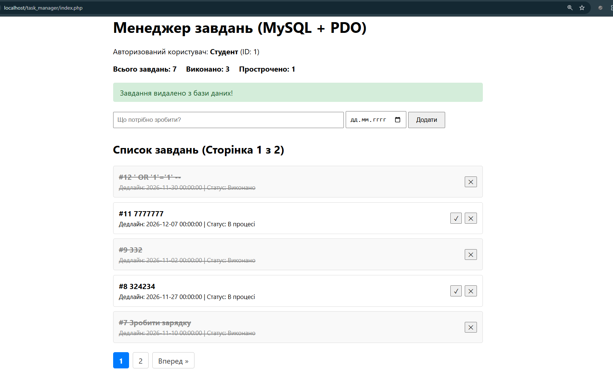
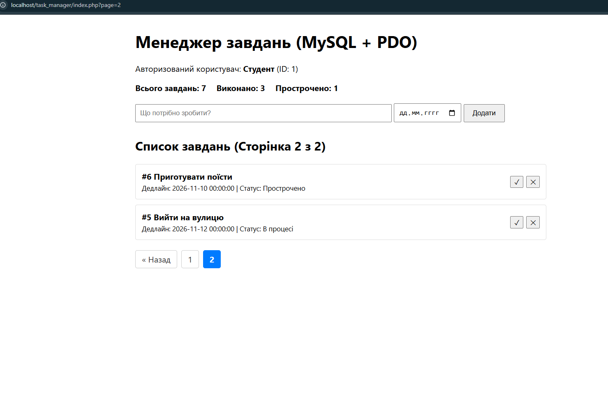
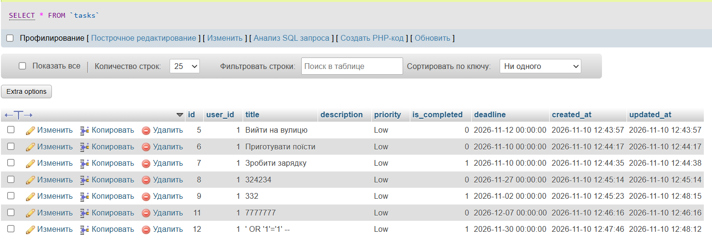

### Фрагмент реалізованих класів
## add()
```php
    public function add(int $userId, string $title, ?string $deadline = null): Task
    {
        $errors = [];
        $trimmedTitle = trim($title);

        if (empty($trimmedTitle)) {
            $errors['title'] = 'Назва завдання є обов\'язковою для заповнення.';
        } elseif (mb_strlen($trimmedTitle) < 3) {
            $errors['title'] = 'Назва завдання має містити щонайменше 3 символи.';
        }

        if (!empty($deadline) && strtotime($deadline) === false) {
            $errors['deadline'] = 'Вказано некоректний формат дати дедлайну.';
        }

        if (!empty($errors)) {
            throw new ValidationException($errors);
        }

        $sql = '
            INSERT INTO tasks (user_id, title, is_completed, deadline, created_at)
            VALUES (:user_id, :title, 0, :deadline, NOW())
        ';

        $stmt = $this->pdo->prepare($sql);
        $stmt->execute([
            ':user_id'  => $userId,
            ':title'    => $trimmedTitle,
            ':deadline' => !empty($deadline) ? $deadline : null,
        ]);

        $newId = (int) $this->pdo->lastInsertId();

        $createdTask = $this->findByIdAndUser($newId, $userId);
        if ($createdTask === null) {
            throw new RuntimeException('Не вдалося отримати створене завдання з бази даних.');
        }

        return $createdTask;
    }
```
## findAllByUser()
```php
public function findAllByUser(int $userId, int $page = 1, int $perPage = 5): array
    {
        $offset = ($page - 1) * $perPage;

        $sql = '
            SELECT id, user_id, title, is_completed, deadline, created_at, updated_at
            FROM tasks
            WHERE user_id = :user_id
            ORDER BY id DESC
            LIMIT :limit OFFSET :offset
        ';

        $stmt = $this->pdo->prepare($sql);

        // При вимкненій емуляції параметри LIMIT та OFFSET мають бути строго цілими числами
        $stmt->bindValue(':user_id', $userId, PDO::PARAM_INT);
        $stmt->bindValue(':limit',   $perPage, PDO::PARAM_INT);
        $stmt->bindValue(':offset',  $offset,  PDO::PARAM_INT);

        $stmt->execute();

        $rows = $stmt->fetchAll();
        return array_map(fn(array $row) => Task::fromArray($row), $rows);
    }
```

## complete()
```php
    public function complete(int $id, int $userId): bool
    {
        $stmt = $this->pdo->prepare('
            UPDATE tasks 
            SET is_completed = 1, updated_at = NOW() 
            WHERE id = :id AND user_id = :user_id
        ');

        $stmt->execute([
            ':id'      => $id,
            ':user_id' => $userId,
        ]);

        if ($stmt->rowCount() === 0) {
            // Перевіряємо, чи взагалі існує завдання
            if ($this->findByIdAndUser($id, $userId) === null) {
                throw new TaskNotFoundException("Завдання з ID {$id} не знайдено або воно належить іншому користувачу.");
            }
        }

        return true;
    }
```

## delete()
```php
public function delete(int $id, int $userId): bool
    {
        $stmt = $this->pdo->prepare('DELETE FROM tasks WHERE id = :id AND user_id = :user_id');
        $stmt->execute([
            ':id'      => $id,
            ':user_id' => $userId,
        ]);

        if ($stmt->rowCount() === 0) {
            throw new TaskNotFoundException("Неможливо видалити: завдання з ID {$id} не знайдено.");
        }

        return true;
    }
```

### Скрін робочог інтерфейсу 
## Сторінка 1

## Сторінка 2


### Вклвдка "Огляд"


### Контрольні запитання
## 1.
PDO — це універсальний об'єктно-орієнтований інтерфейс для роботи з базами даних у PHP. Головні переваги над `mysqli` та `mysql_*`: підтримка багатьох різних СУБД (можна змінити базу без переписування коду) та єдиний зручний стандарт роботи з підготовленими виразами.

## 2. 
Підготовлені вирази відправляють структуру запиту і самі дані на сервер БД окремо. Дані сприймаються суворо як текст, а не як команда. При конкатенації дані змішуються із запитом, що дозволяє зловмиснику вставити власний SQL-код, який виконається базою.

## 3. 
При передачі масиву в `execute()` всі значення за замовчуванням обробляються як рядки (string). База даних вимагає, щоб параметри `LIMIT` та `OFFSET` були суворо цілими числами. Метод `bindValue()` з прапорцем `PDO::PARAM_INT` примусово передає їх як числа.

## 4. 
Цей метод повертає ідентифікатор (ID), який база даних щойно автоматично згенерувала (AUTO_INCREMENT) для нового запису. Його необхідно викликати одразу після успішного виконання (`execute()`) SQL-запиту `INSERT`.

## 5. 
Пагінація реалізується в SQL через `LIMIT` (кількість рядків) та `OFFSET` (скільки рядків пропустити). 
Формула `offset = (page - 1) * perPage` розраховує пропуск:
- Для 1-ї сторінки: (1 - 1) * 5 = 0 (пропускаємо 0, беремо перші 5).
- Для 2-ї сторінки: (2 - 1) * 5 = 5 (пропускаємо перші 5, беремо наступні).
