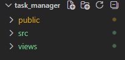
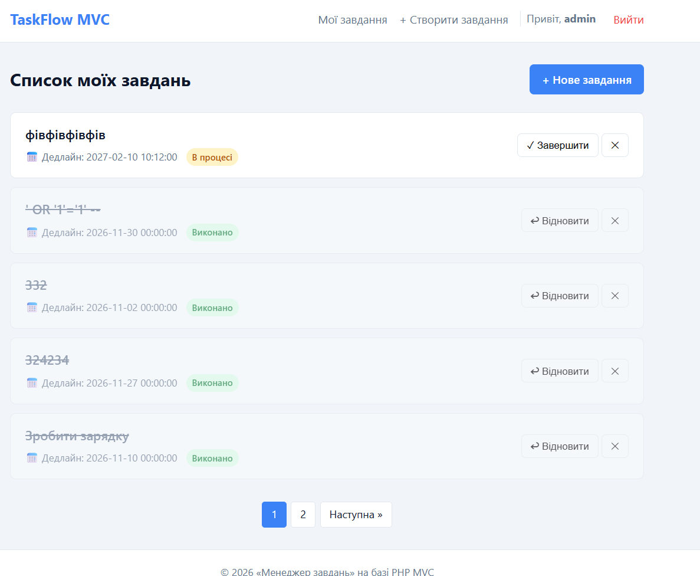
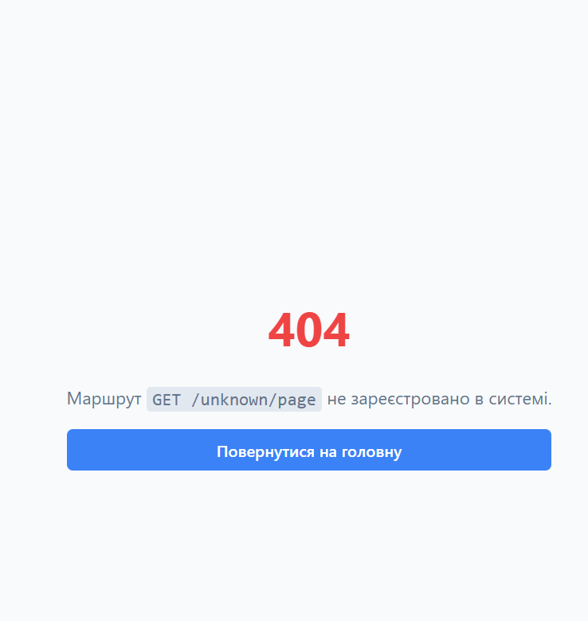

### Фрагмент коду 
## dispatch
```php
public function dispatch(string $method, string $uri): void
    {
        $path = parse_url($uri, PHP_URL_PATH) ?? '/';

        if ($path !== '/' && str_ends_with($path, '/')) {
            $path = rtrim($path, '/');
        }

        $method = strtoupper($method);

        if(!isset($this->routes[$method][$path])) {
            $this->handleNotFound($method, $path);
            return;
        }

        [$controllerClass, $actionMethod] = $this->routes[$method][$path];

        if (!class_exists($controllerClass)) {
            throw new RuntimeException("Клас контролера'{$controllerClass}' не знайдено.");
        }

        $controller = new $controllerClass();

        if(!method_exists($controller, $actionMethod)) {
            throw new RuntimeException("Метод'{$actionMethod}' не знайдено в класі'{$controllerClass}'.");
        }

        $controller->$actionMethod();
    }

```
## render
```php
protected function render(string $view, array $data = []): void
    {
        extract($data);

        $viewFile = __DIR__ . '/../../views/' . $view . '.php';

        if(!file_exists($viewFile)) {
            throw new RuntimeException("Файл представлення не знайдено: {$viewFile}");
        }

        ob_start();
        require $viewFile;
        $content = ob_get_clean();

        $layoutFile = __DIR__ . '/../../views/layouts/main.php';

        if(!file_exists($layoutFile)) {
            throw new RuntimeException ("Файл макета не знайдено: {$layoutFile}");
        }

        require $layoutFile;
    }
```
### Скриншоти
## Скриншот структури каталогів проєкту

## Скриншот браузера зі списком завдань

## Скриншот браузера зі сторінкою 404 


### 1. Призначення складових MVC та їхня взаємодія
Патерн **MVC** розділяє додаток за принципом відповідальності:
* **Model (Модель)** — відповідає за бізнес-логіку, валідацію та роботу з базою даних (CRUD).
* **View (Представлення)** — відповідає за візуалізацію даних (HTML/JSON) без складної логіки.
* **Controller (Контролер)** — посередник: приймає HTTP-запит, передає дані в Model, отримує результат і передає його у View.

**Взаємодія при HTTP-запиті:** Запит потрапляє до **Controller** → він викликає метод **Model** → **Model** дістає/оновлює дані в БД і повертає їх → **Controller** передає дані у **View** → **View** рендерить HTML-відповідь клієнту.

### 2. Концепція Front Controller та її переваги
**Front Controller** — патерн єдиної точки входу, де вебсервер перенаправляє всі запити на один файл (`public/index.php`).

**Переваги перед окремими PHP-файлами (`about.php`, `contacts.php`):**
* **Єдина ініціалізація:** підключення до БД, сесій, конфігів та автозавантаження класів відбувається один раз в одному місці.
* **Централізована безпека:** перевірка авторизації, CSRF-токенів та обробка помилок налаштовуються глобально до виклику контролерів.
* **ЧПУ (чисті URL):** маршрути не прив'язані до фізичних файлів (`/user/5` замість `/user.php?id=5`), що покращує SEO та приховує структуру проєкту.

### 3. Ізоляція коду через налаштування `DocumentRoot` на `public/`
Напрямок `DocumentRoot` виключно на `public/` ізолює системні директорії (`src/`, `views/`, `config/`) від прямого доступу з браузера:
* **Захист конфігурацій:** при збої інтерпретатора PHP вебсервер не віддасть файли з паролями до БД чи API-ключами у вигляді звичайного тексту.
* **Запобігання несанкціонованому запуску:** пряме звернення до файлів у `views/` або `src/` призведе до фатальних помилок (`Undefined variable`) і розкриє внутрішні шляхи сервера.

### 4. Робота компонента Router та роль `parse_url()`
**Router** зіставляє HTTP-метод (`GET`, `POST`) та шлях запиту з таблицею маршрутів, визначаючи потрібний контролер і метод для обробки.

**Навіщо `parse_url($uri, PHP_URL_PATH)`:**
Суперглобальна змінна `$_SERVER['REQUEST_URI']` містить шлях разом із GET-параметрами (наприклад, `/catalog?page=2`). У таблиці маршрутів зберігаються лише чисті шляхи (`/catalog`). Функція відсікає query-рядок після `?`, щоб уникнути хибної помилки `404 Not Found`.

### 5. Механізм рендерингу через `extract()` та буферизацію виводу
* **`extract($data)`** — перетворює ключі асоціативного масиву даних із контролера на локальні змінні (`$title`, `$items`) для зручного використання в шаблоні.
* **`ob_start()` / `ob_get_clean()`** — перехоплює весь HTML-вивід підключеного шаблону в буфер пам'яті та повертає його у вигляді рядка, не відправляючи одразу в браузер.

**Чому шаблони залишаються «чистими»:**
Шаблон отримує вже підготовлені змінні (йому не потрібні запити до БД), а буферизація дозволяє загорнути згенерований фрагмент у загальний макет (`layout.php`) та керувати HTTP-заголовками окремо від верстки.
