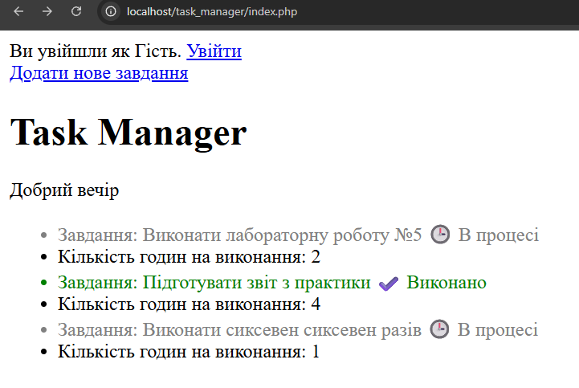
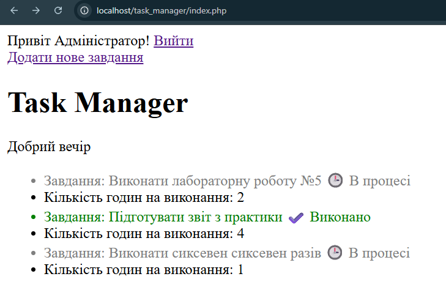

### Авторизація (`login.php`)

```php
<?php
session_start();

if ($_SERVER['REQUEST_METHOD'] === 'POST') {
    if ($_POST['username'] === 'admin' && $_POST['password'] === '12345') {
        $_SESSION['is_logged_in'] = true;
        $_SESSION['user_name'] = 'Адміністратор';
        header('Location: index.php');
        exit;
    } else {
        $error = "Невірний логін або пароль!";
    }
}
```

### Перенаправвлення ('create.php')

```php
session_start();
if (!isset($_SESSION['is_logged_in']) || $_SESSION['is_logged_in'] !== true) {
    header('Location: login.php');
    exit;
}
```

## Скріншоти





## Відповіді на контрольні запитання

1. **Сервер не зберігає пам'ять про попередні запити клієнта. Кожне нове посилання чи сторінка сприймаються як абсолютно нові, тому без сесій чи кук сервер не впізнає користувача.**

2. **Різниця між Cookie та Сесією:**
   * **Cookie** зберігаються у браузері на клієнті.
   * **Сесія ($_SESSION)** зберігається на сервері (у браузері лежить лише її унікальний номер).

3. **Це унікальний ідентифікатор сесії (кука), який слугує "ключем", щоб сервер міг знайти дані конкретного користувача у своїй пам'яті.**

4. **Функція надсилає HTTP-заголовки, які мають йти до будь-якого HTML-коду. Якщо викликати пізніше — буде помилка `Headers already sent`.**

5. **Функція перенаправляє на іншу сторінку, але не зупиняє виконання скрипту. `exit` обов'язковий, щоб зупинити код і не допустити виконання подальших інструкцій.**
